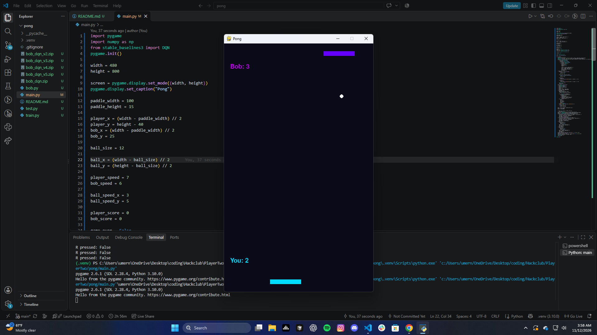

Pong, player VS bob

I made the Pong game using pythong which is pretty simple, first one to 7 points win. Its the player vs Bob, who is a model I made for this game. I trained bob using DQN , so that bob uses a neural network to choose his movements instead of just following the ball

The controls are: Left Arrow = Move left
                  Right Arrow = Move right
                  ESC = Quit
                  R = Restart

I made this using Python 3.10, Pygame, NumPy, Stable Baselines 3, Gymnasium, and PyTorch

To run it, clone the repository, create the virtual environment, activate it, install dependencies, and start the game, also make sure bob_dqn_v5.zip is in the project directory because it is Bob's trained model so that you dont need to train him before playing.

Project includes bob.py, train.py, test.py, main.py

All of the DQN models from 1 to 5 have also been given, you can change the by changing the "model = DQN.load("bob_dqnXXX")" from bob_dqn_XXX to the version you want to see

Made by Mesaki1906 for Hack Club's PlayerTwo event.

## Screenshot

